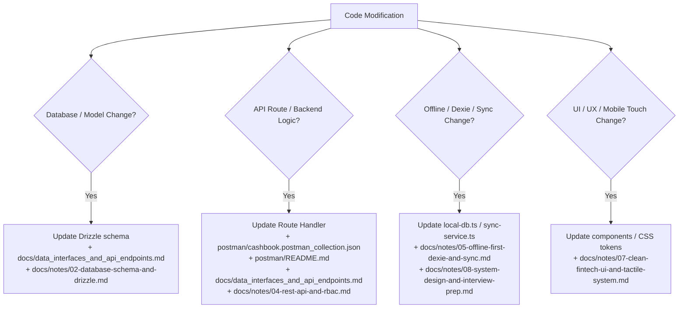

# CashBook Documentation Standards & Continuous Synchronization Guide

This document defines the **mandatory rules, file ownership map, and writing standards** for human engineers and AI coding assistants working in the CashBook codebase. It guarantees that architectural documentation, API contracts, Postman collections, and study guides remain synchronized automatically without developer prompting.

---

## 🗺️ 1. File Ownership & Single Source of Truth Map

To prevent information fragmentation and duplicate content, every document has a strictly bounded responsibility:

| File Path | Domain / Responsibility | When to Update |
| :--- | :--- | :--- |
| **[`docs/project_scope_and_tech_stack.md`](./project_scope_and_tech_stack.md)** | High-level system requirements, multi-tenant scope, and 10–15 year tech stack rationale. | When system boundaries, supported platforms, or core technologies change. |
| **[`docs/data_interfaces_and_api_endpoints.md`](./data_interfaces_and_api_endpoints.md)** | Complete TypeScript data contracts, database index specifications, and REST API route tables. | Whenever a database column, TypeScript interface, or API endpoint signature changes. |
| **[`postman/cashbook.postman_collection.json`](../postman/cashbook.postman_collection.json)** | Machine-executable Postman Collection v2.1.0 with example payloads, query params, and headers. | Whenever an API route is added, modified, or deprecates query/body parameters. |
| **[`postman/README.md`](../postman/README.md)** | Human-readable API documentation with endpoint tables, request/response JSON, and RBAC rules. | Synchronously with the Postman collection. |
| **[`docs/notes/`](./notes/)** | Step-by-step engineering build notebook and module guides (01 through 07). | When implementation details, setup commands, or architectural patterns evolve. |
| **[`docs/notes/08-system-design-and-interview-prep.md`](./notes/08-system-design-and-interview-prep.md)** | Master architectural study guide, domain knowledge explanations, and senior interview Q&A. | When new architectural trade-offs, edge cases, or performance optimizations are introduced. |

---

## ⚡ 2. The Zero-Prompt Continuous Synchronization Rule

> [!IMPORTANT]
> **Mandatory Completion Criterion:** Never wait for the user to request documentation updates. Synchronizing documentation, notes, and the Postman collection is a mandatory step before marking any code task as complete.

### Change Decision Matrix: "Where & What to Write"

---

## ✍️ 3. Senior Technical Writing Principles

### A. Explain the "Why" (Domain Fundamentals & Trade-Offs)
Do not merely state *how* something is implemented; explain the **domain problem** and **why alternatives were rejected**:
* *Bad*: "We use amountPaisa in daily_logs."
* *Good*: "All monetary values are stored strictly as integer minor units (`amountPaisa: integer`). JavaScript uses IEEE 754 floating-point numbers (`0.1 + 0.2 === 0.30000000000000004`). In a ledger with tens of thousands of transactions over 15 years, floating-point rounding errors accumulate and corrupt balances."

### B. Anti-Bloat & Conciseness (The < 400 Line Rule)
* **Never create 1000+ line sprawling, unreadable documents.**
* Use GitHub Flavored Markdown tables, concise bullet points, and ASCII/mermaid sequence diagrams to communicate complex architectures compactly.
* Keep module notes bite-sized (150–350 lines each) so they serve as practical study guides rather than unnavigable text dumps.

### C. Zero Emoji Policy in Technical Documentation & Code
* Emoticons and native emojis (💰, 🚀, 📊) degrade enterprise fintech credibility and render inconsistently across operating systems.
* Use structured markdown alerts (`> [!NOTE]`, `> [!IMPORTANT]`, `> [!TIP]`) and Lucide icon names instead.

### D. Verified File Linking
* Whenever referencing a file or specific line range, use clickable Markdown links formatted with the `file:///` scheme (e.g. `[BookCard.tsx](file:///e:/WebDevs/Projects/cashbook/application/src/components/dashboard/BookCard.tsx#L20-L45)`).

---

## 🎓 4. Structure of Study Modules & Interview Guides

Every engineering study module in `docs/notes/` must adhere to this standard 3-tier structure:
1. **The Problem Statement & Domain Context**: What real-world constraint or edge case necessitates this design?
2. **The Production Architecture & Code Implementation**: How is it cleanly implemented using DRY, typed, split code?
3. **The Interview Angle & Trade-Off Analysis**: What would a staff engineer ask about this decision, and what is the optimal answer?
