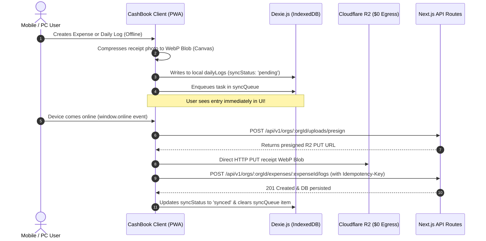

# 05 - Offline-First Engine: Dexie.js & Background Sync

This module explains the offline storage engine, client-side photo blobs, and background synchronization.

---

## 1. Why Dexie.js (IndexedDB) Over LocalStorage?

1. **Storage Limits**: LocalStorage is strictly capped at ~5MB per domain. Dexie (IndexedDB) can store **hundreds of megabytes**, sufficient to cache years of financial ledgers.
2. **Binary Data (Receipt Photos)**: Dexie natively stores raw binary `Blob` objects. An offline mobile user can photograph receipts with their camera; photos are compressed to WebP and stored directly as Blobs in IndexedDB.
3. **Compound Indexes**: Allows sub-millisecond queries on client devices:
   ```ts
   dailyLogs: "id, orgId, expenseId, logDate, [orgId+fiscalYear+fiscalMonth], [orgId+expenseId+logDate]"
   ```

---

## 2. The Offline Sync Lifecycle



---

## 3. Idempotency & Delta Sync

- **Client-Generated UUIDs**: Every log and expense generates a `crypto.randomUUID()` before creation. Passed as an `Idempotency-Key` HTTP header. If mobile network drops during upload and retries, PostgreSQL's `onConflictDoNothing` prevents duplicate double-spending records.
- **Delta Sync (`?since=`)**: The client only downloads records where `updatedAt > lastSyncTimestamp`, reducing mobile data usage to just a few kilobytes.
