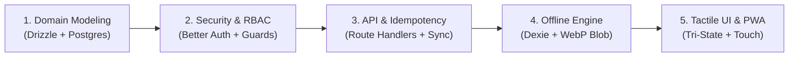

# 08 - System Design, Architecture Fundamentals & Interview Preparation Guide

This module is a **master study guide and technical interview preparation handbook** for the CashBook architecture. It details the domain knowledge, architectural trade-offs ("why this and not that"), step-by-step build blueprint, and high-frequency senior full-stack interview questions.

---

## 🧭 Part 1: The 7 Core Architectural Pillars & Domain Knowledge

```
┌──────────────────────────────────────────────────────────────────────────┐
│                           CASHBOOK ARCHITECTURE                          │
├───────────────────────────────┬──────────────────────────────────────────┤
│ 1. Zero Floating-Point Drift  │ Integer minor units (BDT Paisa / Cents)  │
│ 2. Local-First 0ms UX         │ Dexie.js (IndexedDB) with reactive hooks │
│ 3. Distributed Sync Engine    │ Delta sync (?since=) & Tombstone purges  │
│ 4. Deterministic Ordering     │ logDate DESC + createdAt DESC + id DESC  │
│ 5. 15-Year Storage Economics  │ Cloudflare R2 ($0 egress receipt photos) │
│ 6. Self-Hosted Multi-Tenancy  │ Better Auth + PostgreSQL org_members     │
│ 7. Native Mobile Ergonomics   │ 48x48px hit-slop & promise dialog modals │
└───────────────────────────────┴──────────────────────────────────────────┘
```

### 1. Integer Minor Units (Paisa / Cents) vs. Floating-Point Numbers
* **The Domain Problem**: In JavaScript, numbers follow the IEEE 754 double-precision floating-point standard. Calculations like `0.1 + 0.2` yield `0.30000000000000004`. In banking and ledger systems, floating-point rounding drift across thousands of entries will corrupt account balances and fail audits.
* **The Solution**: All currency amounts are strictly stored and computed as **integer minor units** (`amountPaisa: integer`).
  * ৳1,500.50 is stored as `150050`.
  * Conversions to decimal are deferred exclusively to the display layer (`amountPaisa / 100`).
  * All ledger aggregates (`totalInPaisa`, `totalOutPaisa`, `netBalancePaisa`) use pure integer addition and subtraction, guaranteeing 100% mathematical precision.

### 2. Local-First (Dexie IndexedDB) vs. Server-Centric Fetching
* **The Domain Problem**: Mobile users logging cash transactions are frequently in subways, rural areas, or spots with intermittent internet. Waiting for a server roundtrip before rendering creates sluggish, frustrating UX.
* **The Solution**: **0ms Optimistic Architecture**.
  * The user's screen reads directly from Dexie.js (client IndexedDB) via `useLiveQuery`.
  * New entries write to local IndexedDB in < 5ms and queue in `syncQueue`.
  * Background SWR and `window.online` listeners synchronize local data with PostgreSQL when connectivity is present.
  * Unlike `localStorage` (capped at 5MB, string-only), IndexedDB stores hundreds of megabytes and handles raw binary `Blob` objects for compressed receipt photos.

### 3. Distributed Sync & Soft-Delete Tombstones
* **The Domain Problem**: In distributed offline systems, hard deleting records (`DELETE FROM expenses WHERE id = ...`) causes "phantom data". If Client A deletes a book while Client B is offline, Client B's local database never receives an event about the deleted record. Client B continues displaying the deleted book, and subsequent mutations fail.
* **The Solution**: **Soft-Delete Tombstones (`deletedAt`)**.
  * When a book or entry is deleted, the server sets `deletedAt = now()` and updates `updatedAt = now()`.
  * Cold sync (`!since`) queries filter `isNull(deletedAt)` to keep initial payloads lean.
  * Delta sync (`?since=timestamp`) queries return modified records including those with `deletedAt`.
  * When the client sync worker receives a tombstone, it permanently purges the record and its sub-entries from Dexie.

### 4. Deterministic Multi-Tier Chronological Sorting
* **The Domain Problem**: Logging transactions (e.g. +500, +400, +200, -300) on the same date produced randomized or unstable display order when sorting only by `logDate` (`YYYY-MM-DD`).
* **The Solution**: Multi-tier deterministic sorting:
  1. **Primary**: `logDate DESC` (calendar day).
  2. **Secondary**: `createdAt DESC` (microsecond creation timestamp via ISO 8601).
  3. **Tertiary**: `id DESC` (deterministic string tie-breaker).
* This guarantees that the most recently recorded transaction always displays at the top of the day's group.

### 5. 15-Year Storage Economics: Cloudflare R2 vs. AWS S3
* **The Trade-Off**: Over 15 years, tens of thousands of receipt photos are read and displayed on mobile devices repeatedly.
* AWS S3 charges $0.09 per GB of egress data. A business viewing 50GB of receipts monthly incurs recurring bandwidth costs that compound indefinitely.
* **Cloudflare R2** provides an S3-compatible API with **$0 egress fees**, slashing long-term operational costs to zero bandwidth overhead.

### 6. Self-Hosted Better Auth vs. Third-Party Managed Auth (Clerk / Auth0)
* Managed auth providers charge per Monthly Active User (MAU) and store user identity in proprietary cloud silos.
* **Better Auth** runs directly inside the Next.js process and stores sessions and users in the primary PostgreSQL database.
* This allows atomic joins between users, organizations, and `org_members` within single database transactions without distributed cross-network auth lookups.

### 7. Native Mobile Ergonomics & Anti-Over-Engineering
* **48x48px Hit Slop**: Apple and Google guidelines require 48x48px touch targets. Rather than creating bloated UI buttons, compact buttons use CSS pseudo-element hit slop (`before:absolute before:-inset-2`) to expand touch areas invisibly.
* **Promise-Based Modals**: Instead of pulling in 100KB+ libraries (SweetAlert2), CashBook uses a native Tailwind-styled promise modal with module-level resolvers (`confirmDialog()`), ensuring clean async/await ergonomics with 0 extra runtime dependencies.

---

## 🛠️ Part 2: Step-by-Step Blueprint to Build CashBook from Scratch

Follow this sequential mental model when engineering an offline-first financial ledger:



### Step 1: Database Schema & Minor Units
1. Define PostgreSQL schema using Drizzle ORM (`src/db/schema/*`).
2. Represent all monetary fields as `integer("amount_paisa")`.
3. Add derived fiscal partition fields: `fiscalYear`, `fiscalMonth`, `logDate` (`YYYY-MM-DD`).
4. Establish compound indexes for 100ms queries:
   - Monthly queries: `(org_id, fiscal_year, fiscal_month, log_date DESC)`
   - Delta sync: `(org_id, updated_at)`
   - Tombstone tracking: `(org_id, deleted_at)`

### Step 2: Multi-Tenant RBAC & Session Security
1. Configure Better Auth with Google OAuth and Email/Password.
2. Build `requireOrgMember(orgId, role?)` middleware helper:
   - Verify user belongs to `orgId`.
   - Ensure membership status is `"active"`.
   - Restrict mutation routes (POST, PATCH, DELETE) to `admin` / `editor`; restrict `viewer` to read-only queries.

### Step 3: REST Contracts & Delta Sync
1. Implement idempotent CRUD endpoints under `/api/v1/orgs/:orgId/...`.
2. Support `Idempotency-Key` header with client-generated UUIDs.
3. Build `/api/v1/orgs/:orgId/sync`:
   - If `!since`: Cold sync returning active records (`isNull(deletedAt)`).
   - If `since`: Delta sync returning records with `updatedAt > since`, including tombstones.

### Step 4: Local-First Client Engine (Dexie.js)
1. Initialize IndexedDB schema in `src/lib/local-db.ts`.
2. Configure offline mutation queue: `syncQueue` table for pending mutations.
3. Implement HTML5 Canvas compressor converting camera photos to WebP Blobs before saving to IndexedDB.
4. Set up `window.addEventListener("online", processSyncQueue)` for background replay.

### Step 5: Tactile UI, Tri-State Loading & PWA Service Worker
1. Configure Tailwind CSS v4 design tokens in `globals.css` with zero emojis.
2. Implement tri-state loading on dashboard to prevent "no books found" layout shift.
3. Apply 48x48px touch hit-slop rules to all interactive buttons.
4. Register PWA Service Worker caching app shell and static assets with Cache-First strategy.

---

## 🎯 Part 3: Top 10 Senior Engineering Interview Questions & Master Answers

### Q1: Why do financial applications avoid floating-point math, and how is money handled in CashBook?
> **Answer**:  
> In binary floating-point systems (IEEE 754), fractional base-10 numbers cannot be represented precisely (e.g. `0.1 + 0.2 === 0.30000000000000004`). In a ledger with thousands of entries, this leads to fractional penny drift that corrupts balance reconciliation.  
> In CashBook, all monetary figures are strictly represented as **integer minor units** (e.g. Paisa or Cents). ৳500.25 is stored as `50025`. All database aggregations and client calculations execute pure integer arithmetic. Conversion to decimal strings is deferred exclusively to UI formatters (`amountPaisa / 100`).

---

### Q2: How do you achieve 0ms optimistic UI while maintaining data consistency across offline clients?
> **Answer**:  
> CashBook employs a **local-first reactive architecture**.  
> The UI queries Dexie.js (client-side IndexedDB) via `useLiveQuery`. When a user submits a transaction, it is written immediately to IndexedDB in < 5ms with `syncStatus: 'pending'`, while a sync task is enqueued in `syncQueue`. The UI updates instantly with 0ms perceived latency.  
> In the background, when network connectivity is verified, the sync service flushes the queue to Next.js route handlers using idempotent POST requests. Once acknowledged, the local record's status updates to `'synced'`.

---

### Q3: What is a soft-delete tombstone, and why is hard-deletion dangerous in distributed offline databases?
> **Answer**:  
> In an offline-first system, hard deleting a record (`DELETE FROM ...`) removes it from the server database. When offline clients reconnect and execute a delta sync query (`WHERE updatedAt > lastSync`), the hard-deleted record is not included in the query result because it no longer exists. Consequently, the offline client retains the record in its local cache forever ("phantom data").  
> CashBook uses **soft-delete tombstones** (`deletedAt: timestamp`). When a book or entry is deleted, `deletedAt` and `updatedAt` are set to the current timestamp. Delta sync sends this tombstoned record to the client, prompting the client-side sync worker to purge it from Dexie IndexedDB.

---

### Q4: How does CashBook ensure idempotency during mobile network packet drops?
> **Answer**:  
> On mobile networks, an HTTP POST request may successfully persist on the server, but the network connection may drop before the HTTP 201 response reaches the client. If the client retries naively, duplicate entries ("double spending") are created.  
> CashBook solves this by generating a client-side UUID (`crypto.randomUUID()`) when the user taps submit. This UUID is stored in IndexedDB and sent via the `Idempotency-Key` HTTP header. In PostgreSQL, the insertion uses `ON CONFLICT (id) DO NOTHING`. If a retry occurs, the existing record is returned without duplicating financial transactions.

---

### Q5: How do you prevent Cumulative Layout Shift (CLS) when combining local IndexedDB cache with background server SWR?
> **Answer**:  
> Naive loading flags check `if (books.length === 0) return <EmptyState />`. However, when the page first mounts, Dexie IndexedDB takes ~50ms to open its database handle. During this window, `books.length` is 0, causing the UI to briefly flash "No books found" before snapping to show the actual books when the query resolves.  
> We implemented a **tri-state loading lifecycle**:
> 1. **Hydrating / Loading**: `cachedExpenses === undefined && !hasLoadedServer`. Renders pulsing skeleton cards.
> 2. **Data Present**: `books.length > 0`. Renders ledger cards immediately.
> 3. **Confirmed Empty**: `books.length === 0 && (cachedExpenses !== undefined || hasLoadedServer)`. Only renders the empty state when it is proven that zero records exist.

---

### Q6: Why did you choose Cloudflare R2 over AWS S3 for receipt photo storage?
> **Answer**:  
> Over a 10–15 year operational horizon, a financial ledger accumulates tens of thousands of receipt images that are repeatedly fetched by accounting teams, auditors, and mobile users.  
> AWS S3 charges $0.09 per GB of egress data, turning high-frequency receipt viewing into an unpredictable recurring operating expense. Cloudflare R2 provides an S3-compatible API with **$0 data egress fees**. Combined with client-side WebP canvas compression (reducing ~5MB camera photos to ~150KB), R2 provides near-zero ongoing storage costs.

---

### Q7: How is multi-tenant isolation enforced, and how does RBAC prevent unauthorized edits?
> **Answer**:  
> Every database query without exception scopes by `orgId`.  
> At the API layer, `requireOrgMember(orgId, requiredRole?)` validates the Better Auth session, queries `org_members`, verifies the user belongs to the target organization, and checks that their status is `"active"`. If a `viewer` attempts a mutation (POST, PATCH, DELETE), the endpoint halts with HTTP 403 Forbidden.  
> At the UI layer, `useOrgPermissions()` hides all mutation controls (`+ Add New Book`, quick `+/-` actions, delete buttons) so viewers have a pure read-only experience.

---

### Q8: What is CSS "Hit Slop", and why is it essential for mobile responsive interfaces?
> **Answer**:  
> Apple and Google mobile guidelines require touch targets to be at least 48x48 physical pixels to prevent mistaps. However, in dense financial tables, visually 48px buttons consume excessive whitespace and degrade desktop layout density.  
> We solved this using **CSS hit slop**: the visible button is styled at a compact size (e.g. 32x32px or 34x34px), while an invisible pseudo-element (`before:absolute before:-inset-2 before:content-['']`) expands the interactive hit-box to 48x48px. Combined with `touch-manipulation` (disabling 300ms double-tap delay) and `e.stopPropagation()` (preventing card link triggers), this guarantees fluid mobile touch interactions.

---

### Q9: Why use module-level promise resolvers instead of storing resolver functions inside Zustand state?
> **Answer**:  
> In Zustand, when calling `set({ key: value })`, if `value` is a function, Zustand's internal dispatcher interprets it as a **functional state updater** `(prevState) => nextState` rather than storing the function as a literal value. Storing promise resolvers in state requires awkward nested closures (`() => () => resolve()`) which are fragile and prone to stale execution traps.  
> By keeping `let activeResolve: ((val: boolean) => void) | null` at the module scope, the store only tracks plain JSON data (`isOpen: boolean`, `options: DialogOptions`), while the promise resolution logic remains pure, decoupled, and memory-safe.

---

### Q10: How do you guarantee sub-100ms database query performance over 10–15 years of ledger history?
> **Answer**:  
> Standard queries that scan an entire ledger table degrade linearly ($O(N)$) as data grows into hundreds of thousands of rows.  
> CashBook solves this through **derived fiscal partitioning and compound B-tree indexing**:
> 1. Each entry derives and indexes `fiscalYear` (e.g. `2026`) and `fiscalMonth` (e.g. `11`).
> 2. The primary query uses a compound index on `(org_id, fiscal_year, fiscal_month, log_date DESC)`. This narrows the index scan to only the requested month's partition, keeping queries under 20ms regardless of how many decades of historical data exist in the table.
> 3. Incremental delta syncs leverage `(org_id, updated_at)` to scan only recently modified rows.
