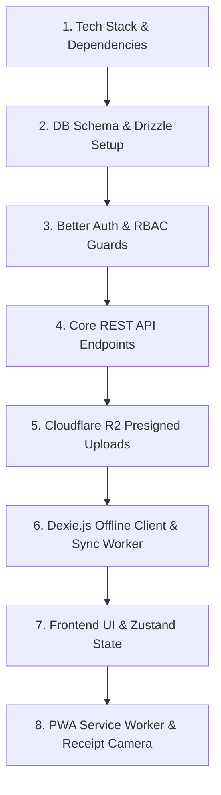

# CashBook Engineering Study Notes & Implementation Guide

Welcome to the CashBook engineering documentation. This notebook is designed as a structured, step-by-step study guide for building and maintaining an **offline-first, multi-tenant financial ledger PWA** architected for **10–15 years of scale**.

---

## 📚 Study Modules Index

| Module | Topic | Description | Status |
| :--- | :--- | :--- | :---: |
| [01. Project Setup & Stack](./01-project-setup-and-tech-stack.md) | Next.js 15 + React 19 + Tailwind CSS | Initial scaffolding, dependency rationale, and clean project folder architecture | ✅ Complete |
| [02. Database & Schema Design](./02-database-schema-and-drizzle.md) | Drizzle ORM + PostgreSQL | Integer minor units (paisa), 15-year compound indexing, and relational schema | ✅ Complete |
| [03. Authentication & RBAC](./03-authentication-better-auth.md) | Better Auth + Session Guard | Self-hosted auth, Google OAuth, email verification, and multi-tenant tenant isolation | ✅ Complete |
| [04. REST API & Endpoints](./04-rest-api-and-rbac.md) | Next.js App Router Route Handlers | Idempotent ledger creation, tenant verification, and delta sync endpoints | 🔄 In Progress |
| [05. Offline Engine & Dexie.js](./05-offline-first-dexie-and-sync.md) | IndexedDB + Offline Sync Queue | Client-side database, binary photo Blobs, and idempotent background sync queue | 🔄 Next |
| [06. External Services Setup](./06-external-services-guide.md) | Neon, Cloudflare R2, Google, Resend | Step-by-step account setup and environment variables guide | ✅ Complete |
| [07. Clean Fintech UI & Tactile System](./07-clean-fintech-ui-and-tactile-system.md) | Mobile Fintech Theme & Interaction | Design tokens, zero-emoji policy, Lucide icon system, and touch feedback | ✅ Complete |

---

## 🗺️ Build Order (Execution Workflow)

---

## 🛠️ Required External Services Checklist

1. **Database**: [Neon Serverless PostgreSQL](https://neon.tech) (Free tier)
2. **Object Storage**: [Cloudflare R2](https://dash.cloudflare.com) ($0 egress fees for 15-year receipt image storage)
3. **Authentication**: Google Cloud Console (OAuth 2.0 Client ID & Secret)
4. **Transactional Email**: [Resend](https://resend.com) (Verification & invites)
